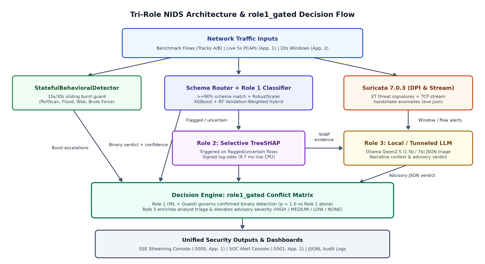
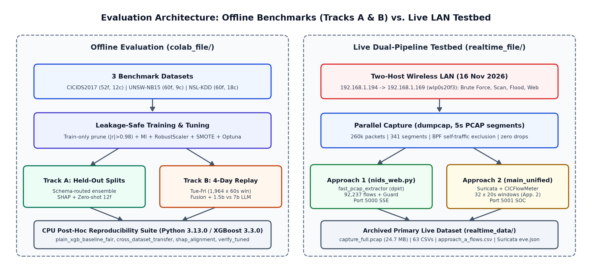

# Tri-Role Machine Learning, Explainable AI, and Local LLM Architecture for Network Intrusion Detection

This repository provides the full training notebooks, offline evaluation pipelines, dual-mode live testbed implementation, primary packet captures, flow datasets, post-hoc verification scripts, and archived execution logs accompanying the manuscript:

> **A Tri-Role Machine Learning, Explainable AI, and Large Language Model Architecture for Network Intrusion Detection: Cross-Dataset and Real-Time Evaluation**

---

## 1. Research Overview & Why Separate Roles?

Machine learning classifiers achieve high accuracy on network flows without explaining why an alert occurred. Post-hoc feature attributions explain individual flows locally, yet cannot reason across multi-flow temporal context. Large language models (LLMs) generate readable security narratives over alert windows, yet exhibit high false-positive rates and high inference latency if placed directly on the binary detection path.

This project separates operational responsibilities across **three non-overlapping roles** coordinated by an explicit **`role1_gated` decision engine**, evaluated across three heterogeneous benchmarks (**CICIDS2017**, **UNSW-NB15**, **NSL-KDD**), four days of full packet-capture replay (**Track B**), and a controlled dual-pipeline live LAN campaign (`live_20261116_combined`).

### High-Level Tri-Role & `role1_gated` Architecture



### Offline Benchmark vs. Live Dual-Pipeline Testbed



### Conflict Resolution Matrix (`role1_gated` Policy)

| Role 1 Decision (ML / Guard) | Role 3 Verdict (LLM) | Resolved Severity | Binary Alert State | Operational Behaviour |
|---|---|---|---|---|
| **Attack** | **Attack** | **HIGH** | Confirmed Attack | Corroborated high-confidence alert (Role 1 label preserved) |
| **Attack** | **Suspicious** / Missing | **HIGH** | Confirmed Attack | Escalated immediately with available context |
| **Attack** | **Benign** | **MEDIUM** | Confirmed Attack | Flagged for review without suppressing ML verdict |
| **Suspicious** | **Suspicious** | **MEDIUM** | Advisory Triage | Surface suspicious context without inflating attack FPR |
| **Benign** | **Attack** | **MEDIUM** | No Attack Alert | Role 3 warning preserved in triage queue for analyst inspection |
| **Benign** | **Suspicious** | **LOW** | No Attack Alert | Contained advisory flag (captures low-rate probes such as W00/W13) |
| **Benign** | **Benign** / Missing | **NONE** | Suppressed | Normal background traffic |

---

## 2. Headline Empirical Findings

| Evaluation Track | Key Benchmark / Metric | Verified Result | Source Artifact / Script |
|---|---|---|---|
| **Track A (Shared Label Space)** | Universal Ensemble (`CICIDS2017` / `NSL-KDD` / `UNSW-NB15`) | **99.91% / 97.26%**, **99.88% / 99.64%**, **81.36% / 60.84%** (Acc / Macro-F1) | [track_a_20261115_072322.json](colab_file/nids_role3/data/results/track_a/track_a_20261115_072322.json) |
| **Track A Ablation (Native Space)** | Plain Default XGBoost vs. Tuned Hybrid on `CICIDS2017` | **79.17%** (`99.43%` acc) -> **91.15%** (`99.88%` acc) | [recompute_fair_baselines.py](colab_file/nids_role3/scripts/recompute_fair_baselines.py) |
| **Zero-Shot Transfer (12 Shared Features)** | `CICIDS2017 -> UNSW-NB15` (`RobustScaler`) | Collapsed to **52.74%** acc / **0.17%** binary F1 (supports schema routing) | [eval_cross_dataset_transfer.py](colab_file/nids_role3/scripts/eval_cross_dataset_transfer.py) |
| **Role 2 SHAP Alignment** | L1-Normalised Hybrid SHAP vs. XGBoost SHAP (Top-15 / Spearman rho) | **93.3% (0.973)**, **86.7% (0.973)**, **93.3% (0.980)** across the 3 benchmarks | [compute_shap_alignment.py](colab_file/nids_role3/scripts/compute_shap_alignment.py) |
| **Track B Fusion (1,964 Windows)** | `Role 1 alone` vs. `role1_gated` vs. `OR` vs. `AND` vs. `Suricata` | `Role 1`: **98.6% F1** (`0.5% FPR`); `role1_gated`: **98.6% F1** (`p=1`); `OR`: **28.2%** (`p~0`); `Suricata`: **28.01%** | [fusion_pooled_all.json](colab_file/nids_role3/data/results/fusion_pooled_all.json), [baseline_suricata.py](colab_file/nids_role3/scripts/baseline_suricata.py) |
| **Role 3 Size Study (Friday, 483 Win.)** | `qwen2.5:1.5b` vs. `qwen2.5:7b` | `1.5b`: **29.8% F1** (`3.2 s/win`); `7b`: **5.5% F1** (`7.6 s/win`, **457 `suspicious` / 22 `attack`**) | [audit_llm_model_compare.py](colab_file/nids_role3/scripts/audit_llm_model_compare.py) |
| **Live LAN Testbed (`live_20261116_combined`)** | Approach 1 (`92,237` flows) + Approach 2 (`32` windows) | **91,405 / 91,820 (99.55%)** attacker coverage, **0/177** benign FPR; **4/52** features shifted `>=10x` | [live_full_report.json](realtime_file/realtime_data/reports/eval/live_full_report.json) |
| **Tuned-Model Integrity Check (CPU)** | Re-scoring Colab models under CPU `XGBoost 3.3.0` / `sklearn 1.9.0` | **100.00%** test-prediction match (`CICIDS2017` **91.02% / 91.15%**) | [verify_tuned_models_cpu.py](colab_file/nids_role3/scripts/verify_tuned_models_cpu.py) |

---

## 3. Repository Structure

```text
.
├── README.md                                     # This guide
├── README_evaluation.md                          # Unified evaluator CLI guide
├── evaluate_nids.py                              # Offline / live / benign-FPR / latency / LLM-audit evaluator
├── NIDS_Model_Train_FIXED_v4.ipynb               # Clean training & Part 13 analysis notebook
├── NIDS_Model_Train_FIXED_v4_with_run_Data.ipynb # Executed notebook containing Colab & post-hoc outputs
├── .gitignore                                    # Tracks code, notebooks, logs & <100 MB primary captures
├── docs/                                         # Rendered README architecture & workflow diagrams
│   ├── tri_role_architecture.png
│   └── offline_live_workflow.png
│
├── colab_file/                                   # Offline benchmark training, evaluation & Track B outputs
│   ├── provenance.json                           # Colab L4 GPU software/hardware configuration
│   ├── label_mapping_table.csv                   # Native -> shared family taxonomy (Table B.2)
│   ├── matched_label_evaluation.csv              # Standalone vs. routed ensemble comparison (Table C.1)
│   ├── cv_summary.csv                            # 5-fold stratified cross-validation summary (Table C.2)
│   ├── smote_ablation.csv                        # SMOTE on/off ablation (Table C.3)
│   ├── plain_xgb_baseline_fair.csv               # Fair default-XGBoost vs. tuned hybrid table (Table 6)
│   ├── perclass_recall_baseline_check.csv        # Native per-class recall diagnostics (§4.5)
│   ├── cross_dataset_transfer.csv                # Zero-shot 12-feature transfer metrics (Table C.4)
│   ├── feature_importance_gain_gini.csv          # XGBoost Gain & RF Gini feature importances (Table 8)
│   ├── hybrid_shap_alignment_summary.csv         # L1-Hybrid SHAP overlap & Spearman rho metrics (Table 8)
│   ├── hybrid_shap_{CICIDS2017,NSL-KDD,UNSW-NB15}.csv
│   ├── results/                                  # Evaluation pickles, Optuna params, CV JSONs & plots
│   └── nids_role3/
│       ├── main_unified.py / main_offline.py     # Unified offline & Track B orchestrators
│       ├── config/settings.yaml                  # Offline thresholds, Role 3 prompt config & chunk caps
│       ├── src/                                  # Modular engine, ingestion, chunker, LLM, dashboard & stats
│       │   └── llm/ollama_analyst.py             # Offline Track B system prompt & strict JSON parser
│       ├── scripts/                              # Baseline, alignment & verification scripts
│       ├── logs/nids_role3.log                   # Track B execution trace
│       └── data/
│           ├── chunks/                           # 1,964 Track B 60s window prompt files (Tue-Fri)
│           └── results/                          # Track A/B JSONs, LLM comparison & archived CPU logs
│               ├── baseline_suricata_pooled_fixed.json
│               ├── llm_model_audit_friday.json
│               └── posthoc_logs/                 # Verbatim stdout logs from all post-hoc scripts
│
└── realtime_file/                                # Dual-pipeline real-time LAN deployment & dataset
    ├── nids_web.py                               # Approach 1: dpkt fast extractor + Role 1 + Guard + Role 2 + SSE (:5000)
    ├── main_unified.py / app.py                  # Approach 2: Suricata + CICFlowMeter 20s window engine + SOC console (:5001)
    ├── config/                                   # Live settings, Suricata threshold suppression & BPF filters
    ├── scripts/                                  # Dual launch orchestrators (start_realtime_both.sh, stop_and_drain.py)
    ├── src/                                      # Runtime extractor, StatefulBehavioralDetector, Role 3 & evaluators
    └── realtime_data/                            # Primary Live NIDS Simulation Dataset (live_20261116_combined)
        ├── MANIFEST.md                           # Dataset inventory
        ├── pcaps/                                # capture_full.pcap (24.74 MB) + 341 x 5s segments (<=11.68 MB)
        ├── csv/                                  # approach_a_flows.csv (61.71 MB), 63 cicflow_csv/*.csv, alerts CSVs
        ├── json/                                 # suricata/ (eve.json, fast.log, stats.log), phases.jsonl, r3.jsonl, debug JSONL
        ├── chunks/                               # 32 live 20s window text chunks
        ├── logs/                                 # Daemon startup/drain & service logs
        └── reports/                              # Consolidated reports & eval JSONs
```

---

## 4. Manuscript-to-Code & Log Traceability

| Manuscript Target | Reproducing Code / Notebook | Verified Output & Archived Log |
|---|---|---|
| **Tables 3–5, A.1–A.2, B.1–B.2, C.1–C.3** | [NIDS_Model_Train_FIXED_v4_with_run_Data.ipynb](NIDS_Model_Train_FIXED_v4_with_run_Data.ipynb) | `colab_file/results/*/evaluation_results.pkl`, `best_hyperparameters.pkl`, `matched_label_evaluation.csv`, `cv_summary.csv`, `smote_ablation.csv` |
| **Table 6 (Default Baselines) & §4.5 Per-Class Recalls** | [recompute_fair_baselines.py](colab_file/nids_role3/scripts/recompute_fair_baselines.py) | [plain_xgb_baseline_fair.csv](colab_file/plain_xgb_baseline_fair.csv), [perclass_recall_baseline_check.csv](colab_file/perclass_recall_baseline_check.csv), [recompute_fair_baselines_output.txt](colab_file/nids_role3/data/results/posthoc_logs/recompute_fair_baselines_output.txt) |
| **Tuned-Model CPU Integrity Check (§4.5, App. D)** | [verify_tuned_models_cpu.py](colab_file/nids_role3/scripts/verify_tuned_models_cpu.py) | [verify_tuned_models_cpu_output.txt](colab_file/nids_role3/data/results/posthoc_logs/verify_tuned_models_cpu_output.txt) |
| **Table 6 Historical Legacy Row (72 raw features)** | [baseline_plain_xgb.py](colab_file/nids_role3/scripts/baseline_plain_xgb.py) | [baseline_plain_xgb_full.json](colab_file/nids_role3/data/results/baseline_plain_xgb_full.json) |
| **Table 7 & Table 12 (Fusion & 1.5b vs. 7b)** | [main_unified.py](colab_file/nids_role3/main_unified.py), [compare_llm_models.py](colab_file/nids_role3/scripts/compare_llm_models.py) | [fusion_pooled_all.json](colab_file/nids_role3/data/results/fusion_pooled_all.json), [llm_model_compare.json](colab_file/nids_role3/data/results/llm_model_compare.json) |
| **Pooled Suricata-Alone Track B Baseline (§4.5)** | [baseline_suricata.py](colab_file/nids_role3/scripts/baseline_suricata.py) (`--pool-dir`) | [baseline_suricata_pooled_fixed.json](colab_file/nids_role3/data/results/baseline_suricata_pooled_fixed.json), [baseline_suricata_pooled_output.txt](colab_file/nids_role3/data/results/posthoc_logs/baseline_suricata_pooled_output.txt) |
| **Table 8 & Figures 5–7 (SHAP & Gain/Gini Alignment)** | [compute_shap_alignment.py](colab_file/nids_role3/scripts/compute_shap_alignment.py) | [hybrid_shap_alignment_summary.csv](colab_file/hybrid_shap_alignment_summary.csv), [feature_importance_gain_gini.csv](colab_file/feature_importance_gain_gini.csv), [compute_shap_alignment_output.txt](colab_file/nids_role3/data/results/posthoc_logs/compute_shap_alignment_output.txt) |
| **Friday 483-Window 7B Verdict Audit (§4.9)** | [audit_llm_model_compare.py](colab_file/nids_role3/scripts/audit_llm_model_compare.py) | [llm_model_audit_friday.json](colab_file/nids_role3/data/results/llm_model_audit_friday.json), [audit_llm_model_compare_output.txt](colab_file/nids_role3/data/results/posthoc_logs/audit_llm_model_compare_output.txt) |
| **Table C.4 (Zero-Shot 12-Feature Transfer)** | [eval_cross_dataset_transfer.py](colab_file/nids_role3/scripts/eval_cross_dataset_transfer.py) | [cross_dataset_transfer.csv](colab_file/cross_dataset_transfer.csv), [eval_cross_dataset_transfer_output.txt](colab_file/nids_role3/data/results/posthoc_logs/eval_cross_dataset_transfer_output.txt) |
| **Tables 9–11 & Table 13 (Live LAN Telemetry)** | [nids_web.py](realtime_file/nids_web.py), [start_realtime_both.sh](realtime_file/scripts/start_realtime_both.sh), [evaluate_nids.py](evaluate_nids.py) | [live_full_report.json](realtime_file/realtime_data/reports/eval/live_full_report.json), [eval_latency_20261116_161114.json](realtime_file/realtime_data/reports/eval/eval_latency_20261116_161114.json) |

---

## 5. Primary Data & `.gitignore` Scope

This repository is structured to stay below GitHub's **100 MB per-file limit** (`~326 MB` total across `2,743` tracked files, **0** files `>= 100 MB`) while preserving all primary experimental data:

- **Included directly in Git**:
  - **Primary raw packet captures**: `realtime_file/realtime_data/pcaps/capture_full.pcap` (`24.74 MB`, merged `260k` packets) and all `341` individual 5 s `segments/*.pcap` (`24.75 MB` total, max `11.68 MB`).
  - **Primary live flow CSVs**: `realtime_file/realtime_data/csv/approach_a_flows.csv` (`61.71 MB`, `92,237` flows + all 52 features), all `63` Approach 2 `cicflow_csv/*.csv` (`<= 23.80 MB` each), `approach_a_r3.csv`, and `approach_b_alerts.csv`.
  - **Suricata, Phase, Role 1 Debug & Runtime Logs**: `realtime_file/realtime_data/json/suricata/` (`eve.json` `71.50 MB`, `fast.log` `6.30 MB`, `stats.log` `1.03 MB`, `suricata.log` `0.15 MB`), `phases.jsonl`, `r3.jsonl`, `unified_alerts.jsonl`, `role1_proba_debug.jsonl` (`64.62 MB`), `realtime_data/logs/`, `colab_file/nids_role3/logs/`, and all `1,964` Track B prompt files (`colab_file/nids_role3/data/chunks/`).
- **Excluded by `.gitignore` (with exact reasoning)**:
  - **Public third-party benchmark datasets** (`colab_file/data/`, `cic_labels/`, `cicflow_csv_labelled/`, `eve_logs/`, `flow_*`): Multi-GB files obtainable directly from the official UNB CICIDS2017, UNSW-NB15, and Kaggle NSL-KDD releases.
  - **Large binary model `.pkl` checkpoints & ZIP bundles** (`colab_file/models/`, `colab_file/cache/`, `realtime_file/*.pkl`, `model/`, `*.zip`): Individual binaries up to `661 MB`; regenerable by running [NIDS_Model_Train_FIXED_v4.ipynb](NIDS_Model_Train_FIXED_v4.ipynb).
  - **`realtime_file/realtime_data/json/flows.jsonl` (`254.43 MB`)**: Exceeds GitHub's 100 MB per-file hard limit; all `92,237` flow records are already preserved identically in `realtime_file/realtime_data/csv/approach_a_flows.csv`.
  - **Duplicate live working copy** (`/realtime_file/data/`) and **local manuscript drafts** (`/review_file/`, `/skill/`).

*(Note: Three tracked primary files sit between `50 MB` and `100 MB` — `eve.json`, `role1_proba_debug.jsonl`, and `approach_a_flows.csv` — which push cleanly to standard GitHub repositories with only a non-blocking `>50 MB` advisory.)*

---

## 6. Quick-Start Reproduction

### A. Verify Post-Hoc Logs & CSV/JSON Outputs (No GPU Needed)

Scripts that aggregate saved CSVs/JSONs run directly with the tracked files; scripts reading `.pkl` splits/models (`recompute_fair_baselines.py`, `verify_tuned_models_cpu.py`, `eval_cross_dataset_transfer.py`) run once benchmark splits/models are generated via the training notebook:

```bash
pip install -r colab_file/nids_role3/requirements.txt

# Pooled 4-day Track B Suricata-alone baseline (gt_threshold = 0.03)
python colab_file/nids_role3/scripts/baseline_suricata.py \
  --pool-dir colab_file/nids_role3/data/results \
  --gt-threshold 0.03 \
  --out colab_file/nids_role3/data/results/baseline_suricata_pooled_fixed.json

# Track B Friday qwen2.5:1.5b vs 7b verdict distribution audit
python colab_file/nids_role3/scripts/audit_llm_model_compare.py

# L1-normalised Hybrid SHAP & Gain/Gini agreement (uses feature_importance_gain_gini.csv if pkls absent)
python colab_file/nids_role3/scripts/compute_shap_alignment.py

# Require generated cache/ and models/ pickles from the training notebook:
python colab_file/nids_role3/scripts/recompute_fair_baselines.py
python colab_file/nids_role3/scripts/verify_tuned_models_cpu.py
python colab_file/nids_role3/scripts/eval_cross_dataset_transfer.py
```

### B. Offline Track B Replay & Unified Evaluation

```bash
cd colab_file/nids_role3
ollama serve &
ollama pull qwen2.5:1.5b

export NIDS_FUSION_MODE=role1_gated
python main_unified.py --mode offline --nids_pkl ../../realtime_file/universal_nids_output.pkl
```

### C. Live Dual-Pipeline LAN Deployment (`realtime_file/`)

Requires Linux with `dumpcap`, `suricata` (`7.0.3`), `python-cicflowmeter`, `mergecap`/`editcap`, and an accessible Ollama endpoint (`http://localhost:11434` or encrypted tunnel URL):

```bash
cd realtime_file

# Option 1: Launch both live pipelines simultaneously (Approach 1 on :5000, Approach 2 on :5001)
IFACE=<interface_name> OLLAMA_URL=<ollama_endpoint_url> OLLAMA_MODEL=qwen2.5:1.5b bash scripts/start_realtime_both.sh

# Option 2: Run Approach 1 standalone streaming dashboard
python nids_web.py --iface <interface_name> --pkl universal_nids_output.pkl --ollama-url <ollama_endpoint_url>

# Clean two-phase drain & evaluation summary
python scripts/stop_and_drain.py
python ../evaluate_nids.py realtime --approach 2 --alerts realtime_data/json/unified_alerts.jsonl
```

---

## 7. Environment Provenance & Methodological Scope

- **Colab L4 Training & Track B Replay**: `Linux 6.6.159+`, NVIDIA L4 (`23,034 MiB`), `Python 3.13.16`, `XGBoost 3.4.1`, `scikit-learn 1.6.1`, `Optuna 5.0.0`, `SHAP 0.54.1`, `imbalanced-learn 0.14.2`, random seed `42` (full provenance in [provenance.json](colab_file/provenance.json)).
- **Post-Hoc CPU Verification**: `Python 3.13.0`, `XGBoost 3.3.0`, `scikit-learn 1.9.0` executed directly against the saved Colab splits/models; supersedes an anomalous earlier Colab multi-class default-XGBoost `CICIDS2017` export whose root cause was not isolated across software version, device, or notebook runtime, while confirming **100.00%** prediction match for the saved tuned models.
- **Live Testbed**: Single two-host wireless LAN (`192.168.1.0/24`), Ubuntu Linux `7.0.0-30-generic` (`Intel Core i3-1215U`, `7.44 GiB RAM`, `Python 3.14.5`, `Suricata 7.0.3`) with remote Ollama GPU inference over TLS tunnel (`16 November 2026`). Adversarial evasion and indirect prompt injection against Role 3 lie outside the current experimental scope.
